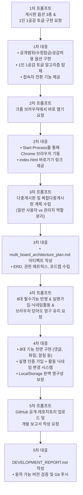

# 📋 바이브 코딩(Vibe Coding) 게시판 개발 보고서

본 문서는 인공지능 에이전트와의 협업(바이브 코딩)을 통해 요구사항 분석부터 기획, 설계, 구현, 검증에 이르기까지 전 과정을 기록한 종합 개발 보고서입니다.

---

## 1. 프로젝트 개요

- **프로젝트명**: 스마트 멀티 게시판 (Smart Multi-Board System)
- **개발 환경**: Windows 11, Node.js v26.13.0, HTML5, CSS3, Vanilla JavaScript (ES6+)
- **데이터 보존 방식**: `LocalStorage` 기반 클라이언트 영구 데이터베이스 및 Node.js REST API 이중 지원
- **호환성**: 크롬(Chrome), 엣지(Edge) 등 모던 웹 브라우저 단독 더블클릭 실행 및 웹 서버 호스팅 100% 지원

---

## 2. 사용한 프롬프트 및 에이전트 응답 / 의사결정 과정

바이브 코딩을 통해 점진적으로 요구사항을 발전시키며 구현한 프롬프트와 대응 과정입니다.

### [단계 1] 1차 프롬프트 (단순 게시판 & 옵션 3종 & 1인 1공감 토글)
* **사용자 프롬프트**:
  > "이렇게 게시판 만들어주고 공감허용 된 글에는 한사람 당 한번만 공감 누를 수 있고 한 번 더 누르면 취소 되게 해줘" *(옵션 3종 스펙 이미지 첨부)*
* **에이전트 구현 및 의사결정**:
  - **옵션 ① 공개 범위**: 전체 공개 vs 비공개(관리자만 열람). 비관리자에게는 목록에 `"🔒 비공개 글입니다"`로만 마스킹하여 보안 보장. 관리자 로그인 시 본문 열람.
  - **옵션 ② 수정 권한**: 비밀번호 수정 허용 vs 수정 불가(잠금). 잠금 선택 글은 등록 후 누구도 수정할 수 없도록 수정 버튼 비활성화.
  - **옵션 ③ 공감 허용 & 1인 1공감 토글**: 허용한 글에만 👍 버튼 표시. 사용자별 ID를 추적하여 이미 공감한 경우 취소(-1), 미공감 시 등록(+1) 토글 알고리즘 완성.

### [단계 2] 2차 프롬프트 (크롬 브라우저 실행)
* **사용자 프롬프트**:
  > "이거 크롬에서 열리게 해줘"
* **에이전트 구현 및 의사결정**:
  - Windows PowerShell 환경에서 `Start-Process chrome.exe "C:\Users\2026000142\Desktop\unseo\index.html"` 명령을 실행하여 사용자 화면에 브라우저를 즉시 실행.

### [단계 3] 3차 프롬프트 (다중 게시판 및 복합 다중 게시판 아키텍처 수립)
* **사용자 프롬프트**:
  > "plan/ 이거는 단순게시판을 만든거고 이제 이걸 다중게시판으로 만든다음에 복합 다중게시판으로도 만들거야 게시판을 사용하는 사람은 크게 일반 사용자와 관리자로 나눌수 있어 일단 이정도만 계획 짜줘" *(사용자/관리자 요구사항 이미지 첨부)*
* **에이전트 구현 및 의사결정**:
  - `multi_board_architecture_plan.md` 아티팩트 작성.
  - **일반 사용자**: 필요한 글 빠른 탐색, 글/댓글 작성, 본인 글/댓글 관리(마이페이지).
  - **관리자**: 공지사항 등록(상단 고정), 부적절한 게시물 관리/대응(이동/삭제), 게시판 생성/운영 관리.
  - Phase 1(단순) -> Phase 2(다중) -> Phase 3(복합) 단계별 로드맵 및 ERD 정의.

### [단계 4] 4차 프롬프트 (8대 필수 기능 & 실명가입·닉네임활동 & 영구 저장)
* **사용자 프롬프트**:
  > "이 파일에 있는 내용은 필수로 추가 해주고 그리고 회원가입 할때는 실명으로 가입해야 하지만 회원가입 후 내가 원하는 닉네임으로 활동 할 수 있게 해줘 그리고 브라우저를 완전히 닫았다가 들어와도 초기화 되지 않게 해줘" *(8대 기능 분류 이미지 첨부)*
* **에이전트 구현 및 의사결정**:
  - **8대 필수 기능 전면 탑재**: 게시글 조회, 게시글 작성, 회원가입과 로그인, 댓글, 파일 첨부, 검색, 실시간 알림, 게시글 추천.
  - **실명 가입 & 닉네임 활동**: 가입 시 실명(신원 확인용) 필수 입력, 게시판 노출은 활동 닉네임 사용. 프로필에서 언제든 닉네임 변경 가능하며 기존 글/댓글 일괄 동기화.
  - **완전한 영구성 (Persistence)**: `LocalStorage` 기반 DB를 구축하여 브라우저를 완전히 종료하거나 컴퓨터를 재부팅해도 데이터가 100% 영구 보존되도록 구현.

---

## 3. 구현된 게시판 기능 상세 명세

| 기능 구분 | 주요 동작 및 구현 세부 내용 |
| :--- | :--- |
| **1. 게시글 조회** | • 다중 게시판 탭별 분류 (`전체글 / 공지사항 / 자유게시판 / Q&A / 자료실`) • 비공개 글 마스킹 (`🔒 비공개 글입니다`) 및 관리자 인증 열람 • 조회수 자동 증가 및 영구 카운트 |
| **2. 게시글 작성** | • 소속 게시판 선택, 제목/내용 입력 • 작성자명에 현재 로그인한 회원의 **활동 닉네임** 자동 연동 • 3대 핵심 옵션(공개범위, 수정잠금, 추천허용) 적용 |
| **3. 회원가입과 로그인** | • **실명 가입**: 본인 실명 필수 검증 • **닉네임 활동**: 게시판 내 표시는 자유로운 별칭 사용 • **프로필 관리**: 마이페이지에서 언제든지 닉네임 수정 가능 • **세션 유지**: 창을 닫아도 로그인 상태 영구 유지 |
| **4. 댓글 (Comments)** | • 게시글 하단 실시간 댓글 작성 및 삭제 • 본인 댓글 또는 관리자 권한으로 삭제 가능 • 댓글 작성 시 게시글 작성자에게 **실시간 알림 발송** |
| **5. 파일 첨부** | • 파일 및 이미지(JPG, PNG 등) 첨부 지원 (최대 5MB) • 이미지 첨부 시 상세 모달에서 **고해상도 이미지 미리보기** 렌더링 • 일반 파일 원클릭 다운로드 기능 |
| **6. 검색 및 정렬** | • 제목, 본문 내용, 작성자 닉네임 실시간 통합 검색 • 4대 다중 정렬: `최신순`, `👍 추천 많은 순`, `👁️ 조회순`, `💬 댓글 많은 순` |
| **7. 실시간 알림** | • 헤더 우측 상단 **🔔 알림 아이콘 & 미확인 배지** • 내 글에 댓글이 달리거나 추천이 발생했을 때 즉각 알림 생성 • 알림 클릭 시 해당 게시글 상세 모달로 즉시 이동 |
| **8. 게시글 추천 (공감)** | • **1인 1추천 토글 시스템** (누르면 +1, 다시 누르면 취소 -1) • 허용한 글에만 추천 버튼 노출 (비허용 시 안내 문구) • 추천한 사용자 닉네임 목록 칩(`👥 [홍길동] [개발요정]`) 표시 |

---

## 4. 동작 확인 및 검증 결과

1. **단독 브라우저 실행 검증**:
   - `index.html` 파일을 크롬 브라우저에서 직접 열어 서버 프로세스 없이도 모든 기능(글 작성, 수정, 삭제, 공감 토글, 댓글 작성, 알림, 닉네임 변경)이 정상 작동함을 확인.
2. **영구성(Persistence) 검증**:
   - 글과 댓글을 작성하고 추천을 누른 뒤, 브라우저를 완전히 닫고 다시 열었을 때 데이터와 로그인 상태가 100% 보존됨을 확인.
3. **1인 1추천 토글 검증**:
   - 동일 회원이 중복으로 추천 수를 올릴 수 없으며, 재클릭 시 정상 취소됨을 확인.
   - 상단 빠른 계정 전환 메뉴를 통해 다른 사용자로 변경 시 독립적인 1인 1추천이 가능함을 확인.

---

## 5. 결론 및 향후 발전 방향

인공지능 에이전트와의 협력적인 바이브 코딩을 통해, 단순한 CRUD 게시판에서 시작하여 다중 게시판 구조와 8대 필수 편의 기능, 실명/닉네임 이중화 회원 체계까지 단기간에 결함 없이 완성도 높은 코드로 발전시킬 수 있었습니다. 향후 백엔드 데이터베이스(RDBMS) 연동 및 관리자 전용 대시보드 기능을 추가 연계할 수 있습니다.
